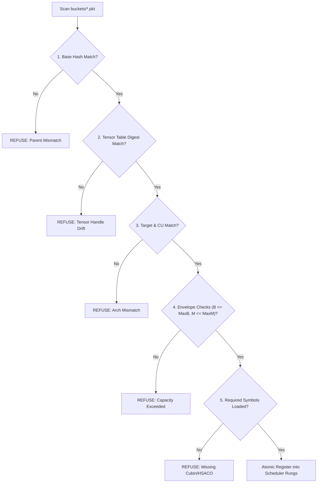

# 31 — Modular Packet Buckets & Sharded Rung Architecture

> A clean, extensible architecture for adding, replacing, and hot-plugging execution buckets and rungs without modifying, re-emitting, or re-qualifying the base `model.pkt`.

---

## 1. Problem Statement

In the legacy distribution model, a compiled model asset produces a single monolithic `model.pkt`:
- It bundles the immutable tensor table (`TensorDecl[]`), static initialization bytes, all prefill bucket programs (e.g., $M \in [128, 256, 512, 1024, 2048, 4096, 8192]$), all decode rung programs (e.g., $B \in [1, 4, 8, 16, 32, 64]$), token-batch bodies, speculative drafting programs, and named metadata sections into a 50–100+ MB binary blob.
- **The Bottleneck:** When an optimization campaign discovers a faster kernel for a single rung (e.g. batch 12), or when traffic demand requires an intermediate prefill bucket (e.g. 3072 rows), adding that single program traditionally required either:
  1. A full model re-emit from the Hugging Face checkpoint, invalidating all existing program hashes and requiring whole-model re-qualification.
  2. Merging into a secondary monolithic `extension.pkt` that bundles all additions into one file, leading to merge conflicts across parallel tuning runs.

**Goal:** Decouple the base tensor contract from execution schedules by supporting **modular, sharded bucket packets** (`buckets/*.pkt`) governed by a lightweight manifest (`buckets.json`), allowing new buckets to be emitted in $\sim 15\text{ ms}$ and hot-plugged with zero downtime.

---

## 2. Directory Layout: `model.pkt.d/`

A modular asset directory separates static model invariants from execution programs:

```
assets/
├── base.pkt                     # Immutable tensor table, arena geometry, KV ring declarations
├── base.map.json                # Device VMM address map
├── manifest.json                # Model manifest and bucket index
├── plow_config.h                # Architectural shared constants (hidden size, head dim, n_cu)
├── weights.json                 # Safetensors weight map
├── requires.json                # Global required kernel symbols
└── buckets/                     # Sharded, standalone bucket/rung programs
    ├── prefill_128.pkt
    ├── prefill_1024.pkt
    ├── prefill_2048.pkt
    ├── prefill_4096.pkt         # Added without re-emitting base!
    ├── decode_b1.pkt
    ├── decode_b4.pkt
    ├── decode_b8.pkt
    ├── decode_b12.pkt          # Added without re-emitting base!
    ├── decode_b16.pkt
    ├── decode_b32.pkt
    ├── decode_b64.pkt
    ├── packed_prefill_2048.pkt
    └── tokenbatch_b4.pkt
```

---

## 3. Container Contracts: Base vs. Bucket

### 3.1 Base Contract (`base.pkt`)
The base packet defines the immutable execution envelope:
1. **Magic:** `PLOWDEV\x0c` (Modular Base Container).
2. **Tensor Table (`TensorDecl[n_tensor]`):** Defines tensor handles, byte counts, and static initialization offsets. Contains zero weights (weights are mapped via safetensors).
3. **Generated Tensors (`PlowGenTensor`):** Parameterized tables (RoPE cos/sin, tensor maps).
4. **KV Cache Geometry:** Ring buffer allocations and head geometries.
5. **Program Count:** `n_prog = 0` (or holds only emergency fallback programs).
6. **Canonical Hashes:**
   - `base_packet_hash`: SHA-256 of `base.pkt`.
   - `tensor_table_digest`: SHA-256 over all `(index, name, bytes, initialized, tp_degree)` tuples in strictly declared order.

### 3.2 Modular Bucket Packet (`buckets/<id>.pkt`)
Each bucket file is an independent, single-program binary artifact:
1. **Magic:** `PLOWBKT\x01` (Modular Bucket Container).
2. **Parent Pinning Header:**
   ```c
   struct PlowBucketHeader {
       uint8_t  magic[8];              // "PLOWBKT\x01"
       uint8_t  base_packet_hash[32];   // SHA-256 of parent base.pkt
       uint8_t  tensor_table_digest[32];// SHA-256 of parent tensor table
       uint32_t target_arch;           // sm_90a, gfx942, etc.
       uint32_t n_cu;                  // CU/SM count compiled for
       uint32_t role_tag;              // ProgramRole discriminant
       uint32_t role_rows;             // Bucket width (M or B)
   };
   ```
3. **Execution Schedule:** Exactly one compiled program: `ProgHeader`, `DevInst64[]`, `StreamEnt[]`, `Wait[]`, and `succ[]`.
4. **Instruction Encoding:** All tensor handles directly index the parent's `base.pkt` tensor table (`0..n_tensor - 1`). No local tensor declarations are allowed.
5. **Scoped Metadata Sections:** Sections relevant only to this program shape (e.g. exact cuBLASLt algorithm ID, segment roles, or role object requirements).

---

## 4. Metadata Manifest (`buckets.json` / `manifest.json`)

A machine-readable JSON descriptor indexes available bucket packets:

```json
{
  "schema_version": "plow.bucket_manifest.v1",
  "base_hash": "e3b0c44298fc1c149afbf4c8996fb92427ae41e4649b934ca495991b7852b855",
  "tensor_table_digest": "4a5e1e...c902",
  "target": "sm_90a",
  "n_cu": 132,
  "max_decode_batch": 64,
  "max_chunk_rows": 8192,
  "buckets": [
    {
      "id": "prefill_4096",
      "path": "buckets/prefill_4096.pkt",
      "sha256": "9b1c...4f21",
      "role": {
        "kind": "PrefillBucket",
        "rows": 4096
      },
      "required_objects": [
        "d_gemm_sm90",
        "d_flash_prefill_sm90"
      ],
      "verified_lean": true
    },
    {
      "id": "decode_b12",
      "path": "buckets/decode_b12.pkt",
      "sha256": "1a2b...3c4d",
      "role": {
        "kind": "DecodeRung",
        "rows": 12
      },
      "required_objects": [
        "d_gemv_sm90",
        "d_flash_decode_sm90"
      ],
      "verified_lean": true
    }
  ]
}
```

---

## 5. Load-Time Invariants & Hot-Plugging

When `plowrt` boots or receives a bucket reload trigger, it validates six fail-closed invariants before adding a bucket to the active scheduling ladder:



1. **Parent Identity Invariant:** `bucket.base_packet_hash == base.hash()`. Refuses loading if compiled against a different base commit.
2. **Tensor Digest Invariant:** `bucket.tensor_table_digest == base.tensor_table_digest()`. Guarantees every `DevInst64` tensor handle index refers to the exact intended tensor and dtype.
3. **KV Ring Allocation Envelope:** Prefill bucket rows $M$ must satisfy $M \le \text{max\_chunk\_rows}$ and $\text{ring\_slots} \ge \text{window} + M - 1$.
4. **Decode Batch Ceiling:** Decode rung rows $B$ must satisfy $B \le \text{max\_decode\_batch}$.
5. **Ladder Monotonicity:** Rung ladders (`prefill_rungs` and `decode_rungs`) are re-sorted upon insertion; duplicate widths are disallowed unless explicitly flagged as atomic replacements.
6. **Lock-Free Hot-Plugging:** The runtime maintains the program ladder behind an atomic pointer (`ArcSwap<ProgramLadder>`). Adding or updating a bucket swaps the pointer in $< 1\ \mu\text{s}$, with zero impact on concurrent decode steps.

---

## 6. Extensibility Benefits

| Capability | Monolithic `model.pkt` | Modular `model.pkt.d/` |
|---|---|---|
| **Add New Rung** | Re-emit whole model (10–30 s + weight scans) | Emit bucket only ($\sim 15\text{ ms}$) |
| **Asset Size per Update** | 50–100 MB | $\sim 50\text{ KB}$ |
| **Hot-Plugging** | Requires full server restart | Zero-downtime hot-swap |
| **Independent Tuning** | Collides across git branches | Parallel standalone files |
| **Verification Scope** | Full-model Lean re-verification | Verify single program only ($\sim 0.2\text{ s}$) |
