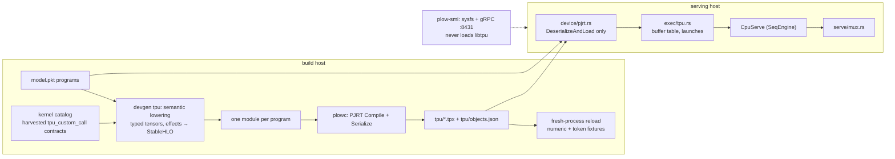

# 31 — Google TPU backend (design)

> **Status: design. Nothing here is implemented, and no TPU-side claim has been run on a TPU.**
> TPU facts are tagged **[doc]** (Google docs, the PJRT C header at API 0.118, JAX source),
> **[re]** (unofficial reverse-engineering notes on one libtpu build; a hypothesis) or
> **[open: En]** (settled by experiment n in §13). Plow facts are from the code.

Plow cannot ship its own kernels to a TPU: the only executable unit is a whole static-shape XLA
program compiled by Google's closed `libtpu.so`. This backend therefore compiles each packet
program to one such executable ahead of time. The chapter defines how the plow contract (packet
+ prebuilt objects, no compiler in `plowrt`) is kept, and how token batching, prefill/decode,
the KV cache and the mux map onto a device that offers buffer handles instead of pointers.

**First scope:** dense decoder LLMs, bf16 weights and bf16 KV, TP1, one host. Rejected at emit
until designed: MoE, MLA latent caches, fp8/quantized weights or KV, recurrent/GDN state,
speech and codec packets, speculative decoding, TP.

---

## 1. What the device gives us

| Property | TPU | Consequence |
|---|---|---|
| Lowest public interface | PJRT C API of `libtpu.so`, input StableHLO **[doc]**; no public ISA | no `runtime/tpu/` interpreter |
| Prebuilt code | `PJRT_Executable_Serialize` / `PJRT_Executable_DeserializeAndLoad`; the blob is platform- and library-version-specific **[doc]**, and sensitive to topology and device assignment **[doc/re]** | the object kind: plowc makes it, plowrt loads it |
| Custom kernels | a Pallas/Mosaic kernel is a `tpu_custom_call` op carrying MLIR bytecode inside the module **[doc]** | spliced in at build time, never loaded separately |
| Shapes | static; bounded dynamism at best **[doc]** | one executable per packet program |
| Memory | HBM is not host-addressable; no reserve/map; buffers are handles; inputs are donatable by default (`non_donatable_input_indices` opts out) **[doc]** | no pointer table, no VMM, no host `memcpy` into KV |
| Completion | `PJRT_Event` (`OnReady`, `IsReady`, `Await`, `Error`) **[doc]** | no device counters; host sequence accounting (§5.3) |
| Ownership | one process holds the chips **[re]** **[open: E3]** | all models, replicas and metrics share one `plowrt` |
| Compiler location | inside `libtpu.so` | "no compiler in plowrt" is behavioural (R1) |

HBM per chip **[doc]**: v5e 16 GiB, v6e 32 GiB, v5p 95 GiB, tpu7x 192 GiB exposed as two
96 GiB PJRT devices. A *chip* is not always one PJRT *device*; §6.4 keeps them apart.

## 2. Rules

- **R1. plowrt never compiles.** The compile entry points (`PJRT_Client_Compile`,
  `PJRT_Compile`, PhaseCompile) keep their slots in the mirrored C table (ABI layout) but have
  no safe wrapper in `plowrt`; a test asserts no call site. Load refuses, by name, an object
  whose compatibility key (§4.2) differs from the live device. There is no fallback.
- **R2. The packet stays the contract.** Program set, tensor table, rungs, buckets, `max_ctx`,
  `serve.json` and weight binding come from `model.pkt`. Each model object names its source
  packet program and is **semantically equivalent** to it (§7.1) under its declared
  specialization; pairing is by `PLOW_PACKET_HASH`, as for a cubin.
- **R3. Specialized executables, no interpreter.** A packet program may have several objects,
  one per declared specialization (context bucket, sampling, K steps). Auxiliary objects such
  as `kvcopy` have their own typed effect contract bound to the packet hash. There is no
  generic interpreter written in StableHLO.
- **R4. State is device-resident, full-capacity and donated.** Persistent state has one shape
  for all programs of a packet, so any object accepts any other's results without repacking.
- **R5. `libtpu.so` is dlopen'd, pinned and not redistributed** (licence: Google Cloud terms).
- **R6. No model branches in plowrt.** Model shape lives in the packet and in typed object
  signatures (§4.3).

## 3. Shape of the system



## 4. Artifacts

### 4.1 Layout

```
<assets>/model.pkt  build.json  weights.json  plow_config.h   # unchanged
<assets>/tpu/objects.json                                      # signatures, key, evidence
<assets>/tpu/<role>-<rows>[-c<ctx>][-k<K>].tpx                 # one serialized executable each
```

Dist changes: `objset_root("google") = "tpu"`; `.tpx` in `OBJSET_SUFFIXES`; a manifest role
for `tpu/objects.json` (an unclassified asset is reported today,
`crates/plowrt/src/dist/manifest.rs`); `runtime_compiled("google") = false`
(`crates/plow-asset/src/dist.rs`). The recipe declares `vendor = "google"`; the isa-prefix
derivation there (`gfx*`→amd, `sm_*`→nvidia, else cpu) gains `tpu_*`→google so a disagreement
is still refused.

### 4.2 Compatibility key

Recorded in `objects.json` and `build.json` `runtime_requires`, checked before any load:

- **what was compiled**: packet hash, module digest, emitter version, catalog card digests,
  StableHLO version, serialized `CompileOptionsProto` (precision, replica and partition counts,
  device assignment), `LIBTPU_INIT_ARGS`;
- **what compiled it**: libtpu digest and version, PJRT API version, `platform_version`;
- **where it runs**: generation, topology, PJRT device ids, argument layouts and shardings.

A libtpu bump republishes every TPU bundle. The dist label carries the pin so two can coexist:
`<isa>-<sku>-tp<n>-<ctx>-lt<pin>`.

### 4.3 Signature

`objects.json` lists, per executable, **every** argument and result in call order, fully
expanded (no globs): packet tensor name, dtype, shape, layout, sharding, and a kind:

| Kind | Meaning | Shape rule |
|---|---|---|
| `weight` | uploaded once; marked non-donatable | packet tensor shape |
| `state` | persistent; donated; result index given | full capacity (`[db]…`, `[ctx]`), identical in every object of the packet |
| `step` | host-written for this launch | bucket-shaped (`[B]`, `[T]`, scalars) |
| `out` | produced for the host | bucket-shaped |

Weights are always parameters, never constants: one device copy serves all objects and nothing
is folded into a blob.

The PJRT executable metadata has no portable per-result alias table **[doc]**. Alias evidence
is therefore produced at build time (optimised HLO and buffer assignment for each `state`
argument), stored in `objects.json` bound to the blob digest, and re-proved behaviourally by
E4's method in `plowrt qualify`. Load checks digests, the key, and that all objects of a packet
agree on every `state` entry.

## 5. plowrt

### 5.1 Device layer — `crates/plowrt/src/device/pjrt.rs`, feature `tpu`

`Backend` (`device/mod.rs`) is byte-addressed: `alloc → DeviceMem{base,len}`, `upload(dst,
off, bytes)`, a required `launch_persistent`. PJRT does not fit it and is not forced into it.
`pjrt.rs` is a typed sibling:

```rust
pub struct PjrtDevice { /* client, devices, api table */ }
impl PjrtDevice {
    pub fn load(&self, tpx: &[u8]) -> Result<Exec>;                    // DeserializeAndLoad
    pub fn buffer_from_host(&self, ty: ElemTy, dims: &[i64], src: &[u8]) -> Result<Buf>;
    pub fn zeros(&self, ty: ElemTy, dims: &[i64]) -> Result<Buf>;
    pub fn execute(&self, e: &Exec, args: &[&Buf], keep: &[i64]) -> Result<(Vec<Buf>, Event)>;
    pub fn to_host(&self, b: &Buf, dst: &mut [u8]) -> Result<Event>;
    pub fn memory_stats(&self, dev: usize) -> Result<MemStats>;
}
```

- Shared with the other backends: inventory, `fingerprint()`, `DevId` (tag `tpu`),
  `dist::live_target`.
- `dlopen` order: `--libtpu` / `PLOW_LIBTPU`, then `$PLOW_HOME/vendor/libtpu/<pin>/libtpu.so`,
  `RTLD_LOCAL` (libtpu embeds tcmalloc and overrides `operator new` **[re]** **[open: E15]**).
- `PJRT_Api_Version` and each struct's `struct_size` are checked before first use.
- Every extension used (none in phase 1) is named in §13 and probed at load.
- New variants: `hwspec::Vendor::Google`, `Arch`/`IsaLevel` `tpu_v5e | tpu_v6e | tpu_7x`,
  `ExecutorClass::TcGoogle`, `DeviceHandle::Tpu`, `ServeEngine::Tpu`, the `abi.json` isa rule,
  tunedb `decode::Backend`.

### 5.2 Memory — a buffer table replaces the pointer table

`PlowProgram.tensors` is a device-pointer table indexed by tensor handle. `TpuEngine` keeps
the same index space over `Buf`:

| Class | Buffer | Notes |
|---|---|---|
| weights | one per tensor, from the mmap'd safetensors | upload path chosen by E10 |
| cache state (`kv.*`) | one per packet cache tensor, full capacity, zeroed on device | donated every launch |
| sequence state (`in.ids`, `in.pos`, `in.kvlen`, `last_token[db]`) | small, full capacity | donated when a program advances them |
| `act.*` scratch | none | program-internal |
| logits for the host | a small `out`: rows gathered by a `step` index list | the baseline; `PJRT_Buffer_CopyRawToHost(offset, size)` exists in the core header but exposes device layout **[open: E11]** |

After a launch the engine replaces each donated handle with the returned one; the table is the
only owner.

**Capacity.** No growth, no VMM: cache state is fully allocated at load, as on CPU and Metal.
A process-wide reservation ledger covers `weights + state + per-object scratch + in-flight
depth × outputs`, checked against `PJRT_Device_MemoryStats`. A model that does not fit is
refused at load and the load rolls back (handles dropped, ledger restored). There is no
co-tenant eviction on pressure at first; `kv_admission_budget` returns `None` as on CPU.
Fragmentation across model loads and executable residency are **[open: E4, E12]**.

"Unified memory" in the Metal sense (host pointer = device buffer) does not exist. The property
the engine needs from it — no per-step copy of state — is R4.

### 5.3 Launch, completion and faults

Device wait/successor counters, `xctr`, counter reset and the GQ cursor do not exist; libtpu
schedules the core.

**Phase 4 is synchronous**: one launch in flight per engine; the tick uploads `step` inputs,
executes, requests the token download, and waits for its event (bounded spin, then park). The
`OnReady` callback does one atomic store and one unpark; it takes no lock and touches no mux
state, because its thread is unspecified **[doc]**.

**Lookahead (phase 6)** is not a consequence of adding atomics. Its contract:

- an execution owns its donated inputs from submit; a handle is never donated twice, and never
  while a download of it is pending — the token snapshot is a separate `out`, not `in.ids`;
- step n+1 is submitted with step n's result handles (PJRT results are futures) **[open: E7]**;
- completions can arrive out of order: the engine publishes a **contiguous completed prefix**
  (`completed_seq` = highest k with all ≤ k done), with the shape of `exec/cpu/control.rs`;
- slot generations and deferred retirement are kept as in `DecodePipe`
  (`exec/gpu.rs`: an unfed row still writes its KV), so EOS, cancel and slot reuse are gated on
  the queued step;
- unload drains in-flight executions before dropping handles.

**Faults.** An event error or a failed execute poisons every `state` handle that execution
owned and every queued generation. The engine fails the affected requests, drops and
re-creates its state buffers, and reports degraded; if re-creation fails the model unloads.
Whether a device fault needs a process restart is **[open: E7]**.

### 5.4 Engine — `crates/plowrt/src/exec/tpu.rs`

Three ways into the mux exist: the CUDA arm calls ~120 `GpuEngine` methods directly; AMD
implements ~46 `SeqEngine` methods; Metal implements `SlotEngine` under `CpuServe`
(`serve/cpu_serve.rs`), which holds a `Box<dyn SlotEngine>` and provides the required
`SeqEngine` surface. TPU takes the Metal route: `ServeEngine::Tpu(CpuServe)`.

`SlotEngine` as it stands:

```rust
fn prefill_buckets(&self) -> Vec<(usize, u32)>;
fn prefill_slot(&mut self, slot: usize, prompt: &[u32]) -> Result<u32>;
fn prefill_slot_chunk(/* slot, prompt, Chunk */) -> Result<()>;
fn last_token(&self) -> Result<u32>;
fn decode_step_batched_at(/* pos, kvlen, ids, decode program */) -> Result<Vec<u32>>;
fn model(&self) -> &CpuModel;                       // ← host-memory model
fn max_ctx(&self) -> usize;   fn describe(&self) -> String;
fn logits_row(&self, row: usize, out: &mut Vec<f32>) -> bool { false }   // optional
```

A preparatory refactor, with no behaviour change on CPU or Metal:

1. Replace `model() -> &CpuModel` with `meta() -> &SlotMeta`. `CpuServe` uses the model beyond
   construction — `decode_prog_for`, `blob.progs` widths — so `SlotMeta` carries: blob program
   table and widths, decode-program selection, `live_kv`, batch, ring slack, prefix
   eligibility. `TpuEngine` loads without `CpuModel` (which resolves CPU kernels).
2. Move the one host-memory operation in `CpuServe` — cross-slot `share_prefix`, a
   `copy_nonoverlapping` per tensor and head — behind `SlotEngine::copy_prefix(from, to, rows)
   -> Result<bool>` with a declining default. Same-slot session resume only moves cursors and
   stays in `CpuServe`.
3. Add capability methods `SlotEngine::{host_sampling, multistep_quantum, multi_step}` with
   declining defaults and `CpuServe` delegation; the existing `pack_rows` and
   `prefill_packed` are kept. `CpuServe` declines multistep and inherits
   `host_sampling = false` today, so without this the wrapper caps TPU at greedy.

`kv_rebase`, instruction patching and reading `last_token` from host memory are internal to the
CPU and Metal engines and have TPU counterparts inside `TpuEngine` (§6.2).

Phase 4 offers greedy plus host sampling (`host_sampling = true`, `logits_row`), and
`honours_sampling` follows from that. If phase 6 needs more than the delegation in (3),
`TpuEngine` implements `SeqEngine` directly; the shared tick body is kept either way, and
`mux.rs` gains no `cfg(feature = "tpu")` behaviour site.

## 6. Serving adaptation

### 6.1 Token batch, rows and rungs

| Mechanism today | On TPU |
|---|---|
| Rung ladder (`PLOW_DECODE_BATCH_LADDER`), recorded positionally in the packet | unchanged; one `decode-<B>.tpx` per rung |
| Rung chosen by **highest live slot**; row b = slot b; idle rows below the extent run as padding with `kvlen = 1` and still write their slot's KV | unchanged. Rung B takes full-capacity state and statically addresses slots `0..B`. No row→slot gather in the ordinary path |
| Mux holds the extent low (`admission_limit`); slots never compact | unchanged |
| Step inputs `in.ids/in.pos/in.kvlen` | `state` at full capacity; the rung reads the first B entries |
| Greedy token: `ARGMAX_FIN` writes `in.ids[b]`, host reads it | the program writes `in.ids` and `last_token[slot]` (state) and returns a `[B]` token snapshot (`out`) for the host |
| `d_last` (every slot's newest token; feeds decode rows riding a packed launch whose `in.ids` holds compact rows) | `last_token[db]` is distinct state for the same reason; packed programs gather from it by slot |
| Device sampler `plow_sample`/`plow_penalize`/`plow_advance` (separate cubin) | phase 6: folded into decode. Needs its own contract: params `[B]`, RNG stream and seed reset per sequence, penalty history `[db][V]` reset on admit, and feedback of host-edited tokens. Frequency/presence/bias rows stay on the host, as on CUDA |
| `PLOW_MULTISTEP=K` (`MultiStep`: ring `[batch][K]`, `fed [batch]`) | phase 6: `decode-<B>-k<K>.tpx`, the step repeated K times (unrolled, or `while` if E8 passes) with the same ring and `fed` semantics |
| `DecodePipe` | §5.3 lookahead |
| `TokenBatch` / packed prefill / mixed step | phase 7; contract below |

**Token-batch contract.** The descriptor's arrays (`input_ids[T]`, `positions[T]`, `active[T]`,
`sample_rows_idx[S]`) become `step` tensors at fixed capacities T and S, with counts
`real_rows`, `sample_rows` as scalars (`S = 0` must skip the output segment). Flattening spans
to a per-row `rowslot[T]` alone loses information, so the launch also carries, per row:
attention bounds (`kv_row0`, `kv_len` of its span) and a reset bit, and per span: `state_slot`,
phase flags (`RESET_STATE | DECODE | SAMPLE`) and row boundaries. Padding rows write no state.
Outputs map back to slots through `sample_rows_idx`. Speculative `rowslot` verify is rejected.

**Context length.** Dense masked attention reads the whole cache extent whatever `kvlen` is.
Two answers, chosen by E9:

1. **Context ladder** — decode objects per `(rung, read-extent bucket)`. The bucket bounds the
   *read extent of full-attention layers only* and is chosen to cover the largest live `kvlen`
   in the extent (for a K-step object, `kvlen + K`). Rules that keep it sound:
   - write positions are never bounded by the bucket (an idle row can sit at a high `pos` with
     `kvlen = 1`);
   - sliding layers ignore the bucket: their ring is `window + chunk − 1` rounded up, `kvlen`
     keeps growing past the wrap, and the read gathers the logical window through the ring mask;
   - RoPE uses absolute positions.
2. **A paged-attention custom call** with runtime grid bounds (Pallas supports data-dependent
   grids via scalar prefetch **[doc]**; the unrolling limit applies to in-kernel loops).

Phase 4 ships (1) with a single bucket.

### 6.2 Prefill and decode

| Mechanism today | On TPU |
|---|---|
| One prefill program per row bucket; long prompts covered by `plan_chunks` | unchanged; `prefill-<T>.tpx` |
| Slot selected by pointer rebase (`kv_rebase`, per-slot tensor tables) | `slot` is a scalar `step` argument |
| lm_head row at `clen − 1`; its argmax is the first token | computed in the program; returned as `out` and written to `last_token[slot]` |
| Segmented prefill, GQ, L2 placement | not applicable; one launch per chunk |
| Prefill and decode alternate on one stream, prefill first, bounded by `PLOW_PF_HOLD` / ITL budget; no preemption | unchanged in the mux. `act.*` is program-internal so sharing it is no longer a hazard; `in.*` is shared state and still requires alternation |
| `max_ctx` baked; runtime may lower, not raise | unchanged |

**Per-launch patches are not one mechanism.** `exec/kvrow.rs` rewrites instruction immediates
per launch, by opcode: the cache write row (`i[3]`; MLA latent caches in `i[2]`, sometimes
with an empty declared list), chunk rebase (attention bounds, row counts, pool counts, and
turning surplus `DsaPoolStash` into NOPs), the lm_head row, and flash/merge split counts.
The emitter therefore owns a **launch-semantics table**: for each opcode, which immediates are
launch-variant and how each derives from the launch scalars `(slot, c0, clen)` and the per-row
state. For the first scope (dense, single span) those three scalars suffice. Split counts
(`nsplit`) are GPU work partitioning and disappear in lowering. An opcode without an entry
fails the emit.

A chunk shorter than its bucket is padded; rows `≥ clen` must not write the cache. The program
writes `select(row < clen, new, old)` unless E4 shows a cheaper form.

### 6.3 Cache state

The engine preserves **logical cache semantics**, not bytes. `live_kv` already describes more
than one layout (head-major, and head-interleaved full-layer rows,
`crates/plow-asset/src/live_kv.rs`), and the device's physical layout is libtpu's. The logical
shape of a dense cache tensor stays `[slot][kv_head][ring][head_dim]` (global: `ring = ctx`;
sliding: power-of-two ring with mask). KV-image export/import goes through an explicit
conversion and is not offered at first.

| Feature | Depends on | On TPU |
|---|---|---|
| Flat addressing, `kvlen` bounds reads, no clear on recycle | nothing | same |
| Global-layer growth (`ensure_rows`, premap, 2 MiB blocks) | VMM | none; full preallocation |
| Budgeted admission, co-tenant eviction | VMM accounting | static ledger (§5.2) |
| Same-slot session resume | cursors only | works unchanged |
| Cross-slot `share_prefix` (CPU/Metal: host copy; plain bf16 without scales; unwrapped prefixes only) | host-addressable KV | phase 7: `kvcopy.tpx` with scalar `(from, to, rows)`; copies exactly `rows` rows (`select` on row index — a rounded-up copy would overwrite rows the target keeps). Same eligibility limits |
| CUDA block store (content-addressed 32-row blocks; address-based `StoreOps`; classes Window, Tail, Scale, State; transfer holds) | a copy kernel, device addresses | later, and a redesign: `memory/kv_store.rs` is address-based and `memory/prefix.rs` owns a `GrowablePool`, so neither is a drop-in policy layer. Needs handle/index storage ops and event-backed fill and hold lifecycles |
| AMD `SharedPrefix` (whole-block multi-map) | VMM aliasing | does not port |

**The deciding question** is whether libtpu updates a donated multi-gigabyte cache in place.
XLA's copy insertion adds copies when old and new values overlap in lifetime (a read of the
cache after a write to it, loop-carried state) **[doc]**, and a flat steady-state
`bytes_in_use` does not rule out a large reused temporary. E4 tests the real pattern.

Fallback if it copies: one buffer per slot per cache tensor, with argument b always meaning
slot b (holes included). It bounds a copy to one slot; it does not make updates efficient, and
it multiplies arguments by `db` (E12).

### 6.4 Mux, co-serving, DP and TP

- **Host logic** — admission, fairness, streaming, backpressure, cancellation, stop handling,
  detokenize — is unchanged.
- **Tick thread**: `run_one_tick` on an `EngineThread`, as for CPU.
- **Co-serving**: `cosched.rs` forbids two models executing at once because of CUDA
  cooperative-grid occupancy. That reason does not transfer; the rule is kept on TPU as an
  explicit choice (one execution per device, turn held to completion) until E7 measures
  concurrent executions. `serve/portable.rs` today assumes device 0 and the CPU/Metal loaders;
  it gains a TPU loader and the ledger.
- **Devices.** Three notions are kept separate: physical chips (what a recipe's `units`
  counts), PJRT devices (two per tpu7x chip), and replica/partition axes of a compiled
  program. `execute_device` relocation is capability-dependent **[doc]** **[open: E13]**; the
  design assumes one object per target device unless E13 shows otherwise.
- **Data-parallel** (first): replicas `m#r` are N engines behind the in-process router
  (`serve/dp.rs`), one per PJRT device.
- **Tensor-parallel** (after DP): baked at compile time. The rank processes, peer scratch and
  `xctr` of `CudaGroupServe` are replaced by one SPMD program; every parameter and state
  tensor needs an explicit sharding or SPMD replicates it. Single host only; multi-host needs
  its own coordination design.

## 7. plowc

### 7.1 Semantic lowering — `crates/devgen`, target `tpu_*`

A packet program is not a dataflow graph: tensors are names and byte sizes, instructions
mutate them, and stream entries encode slice execution and carry protocols. The emitter is
therefore a lowering pass, not a per-instruction translation:

1. **Typed tensors (prerequisite).** devgen declares tensors by name and byte size, like the
   packet's `TensorDecl`. Add compiler-side metadata as devgen constructs each tensor and
   view: element type, logical dimensions, strides, alias ranges. Lowering rejects any
   operand whose type or view is unresolved.
2. **Versioned writes.** Each mutation creates a new SSA version; partial writes become
   updates of the previous version; overlapping views are resolved to index ranges.
3. **Effects.** Read-modify-write and recurrent ordering are kept from the instruction
   dependency edges; stream, wait and successor tables are then dropped.
4. **Launch semantics** (§6.2) turn launch-variant immediates into arguments; the rest fold.
5. **Coverage matrix.** Every opcode in `runtime/common/dev_isa.h` is `lowered`,
   `rejected` or `not-applicable`, and an unlisted opcode fails the emit:

| Class | Examples | First scope |
|---|---|---|
| Mathematics | embedding, norm, GEMM, attention, RoPE, MLP, argmax, top-k | lowered |
| GPU work partitioning | flash split/merge, segments, `GEMM_BLK_PF`, `GEMM_LT_PF` | lowered to the plain operation |
| Cross-GPU protocols | `XREDUCE*`, `XARGMAX_FIN`, `XALLTOALL_HEADS`, `XDCP_GATHER` | rejected (become collectives with TP) |
| Pointer-table forms | `MOE_*` expert tables, `MOE_AITER_FP8_PF`, `INDEX_TP_PF` | rejected |
| Interpreter machinery | GQ, trace, poison, counters | not applicable |

The emitter is Rust, writes one MLIR module per program at a pinned StableHLO version, and
lowers nothing below StableHLO.

**Weights and constants.** bf16 checkpoint tensors are bound by name as today. Transforms the
GPU objects expect (preshuffled weights and scales, device-address tensor maps) are not
applied; generated constants (RoPE tables) become `weight` arguments; tied embeddings share one
argument. Matmul precision is fixed in the compile options, and bf16 rounding points follow
the packet.

### 7.2 Kernel catalog — `scripts/gen_kernels/tpu/`

The counterpart of role cubins. A card is the **complete call contract** of a `tpu_custom_call`
traced from a Pallas kernel at static shapes: operand and result types and layouts, aliases,
side-effect attributes, `backend_config` (MLIR bytecode, flags, memory configs), IR version,
and any sharding context. JAX, jaxlib and libtpu are pinned together per card, and each card
ships a compile-and-reload fixture that runs without JAX. Order of use:

1. none — plain StableHLO is the baseline; measured kernel work may precede phase 6;
2. harvested kernels (Ragged Paged Attention) for decode attention;
3. plow-written Mosaic kernels where (1) and (2) lose by measurement.

Whether a card spliced into a hand-emitted module compiles through the C API is E16, run
before any catalog work. Mosaic limits **[doc]**: shape-specialised cards; block last-two
dimensions multiples of 8×128 unless they span the whole array; f32 matmul results; no
integer reductions.

### 7.3 Object build — `plowc --emit devblob+tpx`

`PJRT_Client_Compile(program, CompileOptionsProto)` → `PJRT_LoadedExecutable_GetExecutable` →
`PJRT_Executable_Serialize` → `.tpx`, then `objects.json`. Recipe: `[target] vendor =
"google"`, `isa`, `sku`, `units`, `toolchain = "libtpu-<pin>"`. Compiling without a TPU
(`PJRT_TopologyDescription_Create` + `PJRT_Compile`) is **[open: E6]**; until it passes,
objects are built on a TPU host.

### 7.4 Checks

- **Lean.** Checkpoints D and F verify the counter/dependency schedule and allocation safety
  over one shared schedule/address-map payload (`crates/lean_verify/src/checkpoints`). A TPU
  object has neither; both are recorded as not applicable. The TPU obligations are separate,
  named checks: **T-own** (each `state` argument has exactly one aliased result; no tensor is
  two arguments), **T-eff** (the lowered effect order respects every packet dependency edge),
  **T-sig** (all objects of a packet agree on `state` entries). K is kept, with GPU scheduling
  knobs out of scope for `tpu_*`.
- **Numerics.** Per-layer and logit tolerances against the HF reference, plus deterministic
  greedy token fixtures. Token-exact agreement across backends alone is brittle, and the CPU
  engine cannot run every packet.
- **Round trip.** Every `.tpx` is reloaded in a fresh process before publish.
- **Without a TPU.** The same `pjrt.rs` runs against the open PJRT CPU plugin (signatures,
  ownership, donation, mux lifecycle) and a fake plugin (callback ordering, injected faults).
  These run in CI; a TPU runner proves hardware behaviour.

## 8. Identity and distribution

- Fingerprint: PCI vendor `0x1ae0`, device id → generation, chip count; HBM from
  `PJRT_Device_MemoryStats`; driver = libtpu version. `plowrt target --json` reports
  `vendor: "google"`, `units` = chips, and the PJRT device count separately.
- Selection (`plow_asset::dist::assess_one`): vendor, isa and device count exact — no
  oversubscription, since an object is bound to its topology — plus the libtpu pin being
  installed or installable.
- `plowrt pull` fetches the pinned libtpu wheel from PyPI into `$PLOW_HOME/vendor/libtpu/<pin>`
  and checks the digest named by the bundle. Nothing of Google's enters the plow registry.

## 9. Load and warm-up

Load = verify key → deserialize each object → upload weights → create state → one warm
execution per object. Each stage is timed and reported separately (deserialize, weight
transfer, state init, first token). The object count is `prefill buckets + rungs × ctx buckets
(× K variants)`; if deserialize time or residency makes that too expensive, objects load
lazily by rung with the widest first **[open: E5]**.

## 10. plow-smi

Separate repo, off the critical path. Today `plows-exporter/src/collector/tpu.rs` scrapes
`http://localhost:8431/metrics` as Prometheus text and covers v2–v5p; that port is a gRPC
service (`tpu.monitoring.runtime.RuntimeMetricService`) **[doc]**, and TPUs are invisible to
`top` and `ctl`.

- `plows-gpu/src/backend/tpu.rs`: inventory from `/sys/bus/pci/devices` with no workload
  running; generation table; HBM capacity; owner pid from `/proc/*/fd` on `/dev/vfio/<group>`.
- Runtime metrics over gRPC from the process holding the chips: duty cycle, TensorCore
  utilisation, HBM used/total. No service means an idle device, not an error.
- Temperature and power from the AI Telemetry Collector endpoint when present **[open: E14]**.
- Never loads libtpu. Emits the existing `gpu_*` metric names; inferos gets a fixture captured
  on a real node.

## 11. Phases

| # | Deliverable | Gate |
|---|---|---|
| 0 | `tools/tpu-probe` (Rust, PJRT C API only): E1–E4 | **E4 passes**: one attention block with donated cache, AOT round trip in a fresh process — correct, and at fixed read extent and update size, growing the donated capacity adds neither capacity-proportional latency nor a capacity-sized temporary |
| 1 | remaining experiments E5–E16 | numbers recorded in this chapter; §6.1 and §6.3 choices fixed |
| 2 | `device/pjrt.rs`, R1 test, CPU-plugin and fake-plugin tests; `SlotEngine` refactor | hand-made `.tpx` loads and steps; CPU/Metal suites unchanged |
| 3 | semantic lowering + object build for the first scope; identity and dist (`.tpx`, key, label) | per-layer tolerances on Llama-68M and Qwen3-0.6B |
| 4 | `TpuEngine` under `CpuServe`: greedy + host sampling, one ctx bucket, rung ladder, synchronous; process-wide reservation ledger | serves through the mux; token fixtures pass; load stages timed |
| 5 | data-parallel over devices; multi-model co-serving qualification | N replicas on one VM |
| 6 | in-program sampler, multistep K, lookahead, ctx ladder | ITL and throughput against vLLM-TPU on the same VM |
| 7 | `kvcopy`; token batch and packed prefill | mux prefix and mixed-step tests pass on TPU |
| 8 | kernel catalog; block store; TP | each against phase 6 numbers |

plow-smi (§10) proceeds in parallel from day one. Per the repository's performance order
(`docs/bringup/agent-tools.md`), phase 6 tuning and any peer comparison wait for calibrated
block-vs-roofline tables, a fusion review and per-op targets; kernel or catalog work those
measurements call for is done first. Phase 8 keeps the block store and TP.

## 12. Risks and decisions

- **In-place cache update (E4).** Decides §6.3 and whether phase 3 starts.
- **Lowering effort (§7.1).** The largest piece of new code; scope is held by the coverage
  matrix.
- **Masked attention cost (E9).** Decides ladder vs custom call and the object count.
- **libtpu churn.** A release about every two weeks; blobs are build-bound; a deserialize
  abort on tpu7x was reported on 2026-11-18 (google-pytorch/torch_tpu#6802). Mitigation: pin,
  republish per pin, keep two pins live.
- **Licence.** No redistribution grant is visible; fetch at install. Needs legal sign-off
  before a node image contains libtpu.
- **HBM.** Full preallocation on v5e (16 GiB) fits small models only; first target v6e or tpu7x.
- **Decisions needed:** accept R1 as behavioural; accept R3; first target generation and VM
  shape; whether MoE or fp8 must be in the second scope.

## 13. Experiments

| | Question | Method |
|---|---|---|
| E1 | Inventory and identity | PCI ids, `iommu_group`, `/dev/vfio`, metadata `accelerator-type` / `tpu-env`, `TPU_*` env |
| E2 | Bare host without Python | `dlopen`, `GetPjrtApi`, `PJRT_Client_Create` with no options; required env and hugepage settings; devices and attributes |
| E3 | Single ownership | a second process while the first holds the client |
| **E4** | **Donated cache in a real block** | one attention block: runtime-indexed decode write, ragged chunk write (`row < clen`), attention read of the updated cache, ring wrap, token readback; K-step variant. Compile → serialize → fresh-process load. Sweep donated capacity 1–16 GiB separately from the attention read extent (extent cost is E9); record latency, peak `bytes_in_use`, optimised HLO and buffer assignment |
| E5 | Serialization contract and load time | load on another VM, device count, libtpu version, generation, device assignment; time compile, deserialize, first execution; many objects resident |
| E6 | Off-box compile | `PJRT_TopologyDescription_Create` + `PJRT_Compile` without TPUs |
| E7 | Launch overhead, chaining, faults | 10k trivial launches; submit n+1 on n's result futures; `kMaxInflightComputations` 1 vs 2; callback thread; behaviour after an injected error |
| E8 | K steps in one launch | unrolled K vs `while` with early exit |
| E9 | Read cost vs context | decode attention at `kvlen` 512 inside extents 2k/8k/32k; a scalar-prefetch grid kernel |
| E10 | Upload path | `BufferFromHostBuffer` semantics, `DmaMap`, GB/s from mmap |
| E11 | Partial readback | row-gather `out` vs `PJRT_Buffer_CopyRawToHost` (layout, alignment) |
| E12 | Argument count and residency | objects with 10²–10⁴ parameters; fragmentation after load/unload cycles |
| E13 | Multi-device | one object on each device via `execute_device`; SPMD over 4; device-to-device copy |
| E14 | Telemetry | gRPC `ListSupportedMetrics` idle and busy; collector endpoint |
| E15 | Address space | RSS after `dlopen`; allocator conflicts under `RTLD_LOCAL` |
| E16 | Custom call outside JAX | a harvested `tpu_custom_call` contract in a hand-emitted module compiles through the C API and reloads |
